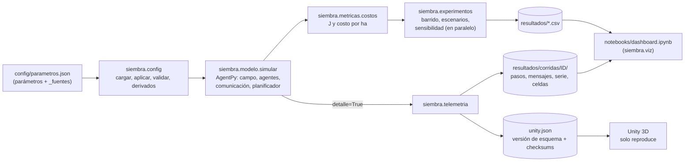
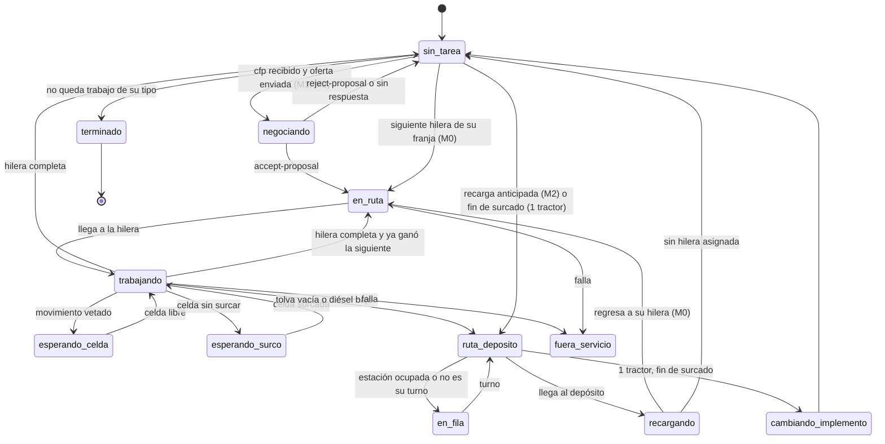

# Modelo implementado y desviaciones respecto a la propuesta

Este documento describe la simulación tal como quedó en el código, regla por regla. La referencia de diseño es `Propuesta.pdf`. Cuando el código hace algo distinto de la propuesta, o precisa algo que la propuesta dejaba abierto, se marca con **Dk** y se explica por qué. La tabla del final reúne todas las desviaciones.

Los nombres de columnas, estados y archivos son los de [`contrato_datos.md`](contrato_datos.md). Los valores numéricos son los del caso base de [`config/parametros.json`](../config/parametros.json) (versión de parámetros `0.1.0`).

## 1. Capas del sistema

Python es la única fuente de verdad: simula, calcula métricas y exporta. El dashboard y Unity solo leen archivos generados.



| Capa | Qué hace | Qué no hace |
|---|---|---|
| Simulación (`siembra/`) | Reglas del campo, decisiones de los tractores, mensajes, rutas, métricas | No dibuja |
| Telemetría | Guarda cada paso, cada mensaje y el estado final de cada celda; exporta el JSON para Unity | No recalcula nada |
| Dashboard (Jupyter) | Lee los CSV y las corridas guardadas y hace todas las tablas y gráficas | No tiene números escritos a mano |
| Unity | Reproduce una corrida a partir del JSON | No decide rutas ni asignaciones |

Dentro de cada paso de simulación el orden es fijo (`ModeloSiembra.step`): (1) en M2, se reconstruye la tabla de reservas; (2) el depósito procesa sus mensajes y sus subastas; (3) se revisa si toca la falla; (4) cada tractor decide, en orden de prioridad; (5) la capa reactiva resuelve los movimientos; (6) cada tractor actúa (surca, siembra, gasta diésel); (7) se verifica la seguridad y se registra el paso.

## 2. Escala de tiempo y espacio

Un paso es el tiempo que tarda un tractor en trabajar una celda. Se calcula con la capacidad teórica de ASABE D497 sin aplicar eficiencia de campo (las vueltas, traslados y recargas se simulan, así que aplicar la eficiencia las contaría dos veces). Lo calcula `config.derivados(cfg)`:

| Derivado | Fórmula | Caso base |
|---|---|---|
| `capacidad_teorica_ha_h` | velocidad (km/h) × ancho (m) ÷ 10 | 9 × 3.04 ÷ 10 = 2.736 ha/h |
| `paso_s` | 0.01 ha ÷ capacidad × 3600 | 13.16 s |
| `pasos_dia` | jornada × 3600 ÷ `paso_s` | 2,736 pasos por jornada de 10 h |
| `tolva_celdas` | `tolva_ha` ÷ 0.01 | 200 celdas (2 ha) |
| `pasos_recarga_semilla` | 15 min ÷ `paso_s` | 68 pasos |
| `pasos_recarga_diesel` | 8 min ÷ `paso_s` | 36 pasos |
| `pasos_cambio` | 20 min ÷ `paso_s` | 91 pasos |
| `diesel_paso_l` | 10.5 L/h × `paso_s` ÷ 3600 | 0.038 L por paso en movimiento |

**Equivalencia celda contra implemento.** Una celda mide 10 m y la sembradora de referencia 3.04 m (4 surcos a 76 cm). Una "hilera" de la simulación (una columna de 10 m de ancho) equivale a unas 3.3 pasadas reales de la sembradora, o unos 13 surcos de 76 cm. Esto tiene consecuencias en las vueltas y los traslados que se discuten en [`analisis_critico.md`](analisis_critico.md#5-limitaciones-del-modelo).

## 3. El campo

### 3.1 Geometría (D1)

El grid mide `ancho = n` por `alto = n + 3` celdas de 10 × 10 m, con `n = round(√(ha · 100))` (`config.lado_campo`).

| Fila `y` | Uso | Se siembra |
|---|---|---|
| 0 | Patio del depósito | No |
| 1 | Cabecera sur | No |
| 2 a n + 1 (`y0` a `y1`) | Área de trabajo: n × n celdas ≈ las hectáreas pedidas | Sí |
| n + 2 | Cabecera norte | No |

`x` va de oeste (0) a este (n − 1). Una **hilera** es una columna `x` del área de trabajo.

| Campo pedido | `n` | `alto` | Celdas de trabajo | Hectáreas sembrables | Largo de hilera |
|---|---|---|---|---|---|
| 10 ha | 32 | 35 | 1,024 | 10.24 | 320 m |
| 20 ha | 45 | 48 | 2,025 | 20.25 | 450 m |
| 40 ha | 63 | 66 | 3,969 | 39.69 | 630 m |
| 80 ha | 89 | 92 | 7,921 | 79.21 | 890 m |
| 160 ha | 126 | 129 | 15,876 | 158.76 | 1,260 m |

El costo por hectárea se divide entre `ha_sembrables` (celdas de trabajo menos obstáculos, × 0.01), no entre las hectáreas pedidas. La propuesta decía 127 × 127 celdas para 160 ha; el redondeo da 126.

> **D1.** La propuesta dibujaba las cabeceras como las franjas superior e inferior *del* campo y no tenía patio. El código separa patio, cabeceras y área de trabajo para que el área sembrable sea exactamente n × n y para que el depósito y los tractores estacionados no bloqueen la cabecera sur.

### 3.2 Depósito y posiciones iniciales

El depósito está en el patio (fila 0), al centro de la orilla sur (`x = n // 2`), o en la columna que diga `campo.deposito_x`. Es una sola estación: ahí se recarga semilla, se recarga diésel y se cambia implemento, un tractor a la vez.

> **D22.** La propuesta no dice cómo se usa la celda de la estación. En el código no es camino de paso (ningún planificador la usa para cruzar el patio; solo entra quien va a cargar), y "estación ocupada" significa que alguien está cargando (`en_servicio` en el blackboard), no que haya un tractor encima de la celda.

Los tractores empiezan en el patio, a 2 celdas o más del depósito (los más cercanos primero). Cuando terminan se estacionan en las celdas del patio más lejanas al depósito.

### 3.3 Obstáculos

Hasta 2 obstáculos fijos: un poste (1 × 1) y un árbol (2 × 2). Se colocan al azar con la semilla de la corrida (`campo.n_obstaculos`), dejando 2 celdas de margen a las cabeceras y a los bordes y sin que se toquen entre sí, o se dan explícitos en `campo.obstaculos`. Ningún tractor puede pisarlos. `config.validar` rechaza obstáculos fuera del campo, en el patio o en una cabecera.

### 3.4 Estados de celda y costos de A* (D2)

Las celdas de trabajo solo avanzan en un sentido: libre → surcada → sembrada. Un obstáculo nunca cambia.

| Movimiento | Costo en A* (`campo.costo`) |
|---|---|
| Entrar a una celda de patio | 1.0 |
| Entrar a una celda de cabecera | 1.0 |
| Entrar a una celda libre | 1.3 |
| Entrar a una celda surcada | 1.6 |
| Entrar a una celda sembrada | 2.0 |
| Cruzar de una hilera a otra (lateral dentro del área de trabajo) | 4.0 (`PESO_CRUCE`) |
| Entrar a un obstáculo | no transitable |

A* usa la distancia Manhattan como estimación, que es admisible porque ningún movimiento cuesta menos de 1. Cooperative A* usa la distancia real del mapa (sección 7.3).

> **D2.** La propuesta pone "A* con costos variables por tipo de celda" como objetivo de aprendizaje pero no define los costos. Estos valores hacen que los traslados prefieran las cabeceras, eviten pasar sobre lo ya sembrado (menos compactación) y no crucen hileras salvo que sea necesario. El conteo de entradas por celda queda en `celdas["pasadas"]`.

## 4. Movimiento y capa reactiva

### 4.1 Reglas de movimiento (D3)

- 4 vecinos, 1 celda por paso (13.16 s), o esperar en el lugar.
- Dentro del área de trabajo el tractor avanza a lo largo de la hilera (norte o sur). Puede cruzar a la hilera de al lado (este u oeste), pero ese movimiento cuesta 4.0 en el planificador, contra 3.3 de dar la vuelta por la cabecera (salir a la cabecera 1.0, moverse en lateral 1.0, entrar a una celda libre 1.3). Por eso el planificador sigue prefiriendo la cabecera y solo cruza hileras para rodear a otro tractor o a un tractor descompuesto.
- En patio, cabeceras y el anillo de una celda alrededor de un obstáculo, el movimiento lateral cuesta lo normal (rodear el obstáculo no se castiga).
- La celda del depósito no es camino de paso: solo entra el tractor que va a cargar o a cambiar implemento.
- Un tractor sin tarea sale del área de trabajo hacia la cabecera más cercana y no se queda junto al depósito, para no estorbar.

Por eso las vueltas ocurren en las cabeceras, que es justo donde aparecen los conflictos del problema 3 de la propuesta (surcador y sembradora dando vuelta en la misma cabecera).

> **D3.** La propuesta solo dice que cada tractor se mueve una celda por paso. El costo de cruce hace que el recorrido sea en hileras (boustrophedon) como en un campo real, sin "cortar" a través de lo ya surcado. Una versión anterior prohibía del todo el movimiento lateral dentro del área de trabajo; con eso cada hilera era un carril de una sola celda de ancho y cualquier encuentro de frente entre dos tractores quedaba bloqueado para siempre.

### 4.2 Capa reactiva y seguridad (D4)

Cada tractor propone un movimiento (su capa deliberativa) y la capa reactiva (`ModeloSiembra._resolver`) lo veta si la celda destino:

- está ocupada por otro tractor al inicio del paso,
- ya la reclamó en ese mismo paso un tractor de mayor prioridad,
- la ocupa un tractor descompuesto,
- no es vecina válida, o el tractor no tiene diésel.

La prioridad es fija: primero los surcadores, después las sembradoras, y dentro de cada rol por nombre (T1, T2, ...). Con estas reglas dos tractores nunca comparten celda (sin colisiones), dos vecinos nunca intercambian posiciones (sin intercambios) y un tractor que sigue a otro queda siempre al menos a una celda de distancia. Cada veto se cuenta en `resumen["vetos"]`, y un tractor vetado que estaba trabajando o en ruta pasa a `esperando_celda`.

> **D4.** Como las colisiones son imposibles por construcción, `colisiones` e `intercambios` valen siempre 0 y el término λ₃·N_col de J nunca pesa. Para medir conflicto se usan `vetos` (movimientos bloqueados) y `W_conflicto_h` (horas en `esperando_celda`). El modelo sigue contando colisiones e intercambios después de cada paso (`_verificar_seguridad`) como comprobación.

### 4.3 Antibloqueo (D5)

- **Paciencia escalonada (M0 y M1).** Un tractor tolera `paciencia_pasos + 3 · (N − 1 − i)` pasos bloqueado, donde i es su índice (T1 = 0): el de menor prioridad se impacienta primero, así dos tractores de frente no replanean al mismo tiempo con movimientos simétricos.
- **Bloqueo mutuo (M0 y M1).** Si dos tractores quieren cada uno la celda del otro, retrocede el de menor prioridad (o cualquiera de los dos cuando lleva 3 veces su paciencia) a una celda libre, de preferencia fuera de las hileras. Nunca retrocede a una celda que le falta trabajar de su propia hilera ni a la estación.
- **Replaneo (M0 y M1).** Si el bloqueo no es mutuo, el tractor replanea con A* tratando a los demás tractores como obstáculos.
- **M2.** Cooperative A* evita la mayoría de los bloqueos con las reservas; si aun así un tractor lleva 3 veces su paciencia bloqueado, replanea tratando a los demás como obstáculos.
- **Fila de la estación.** La estación está ocupada cuando alguien está cargando (`en_servicio` en el blackboard), no cuando hay un tractor encima de la celda. Si está ocupada, el que llega espera a 2 celdas o menos (`en_fila`); si queda pegado al depósito demasiado tiempo, se hace a un lado a distancia 2 para no tapar la salida.
- **Corte.** Si no se trabaja ninguna celda en `simulacion.max_estancado_pasos` pasos (1,500), o se llega al límite de `max_pasos_factor · celdas + 5000` pasos, la corrida termina y se marca `estancado = True`.

> **D5.** La propuesta lista "manejo de bloqueos cuando dos tractores esperan indefinidamente" como pendiente por investigar. Esta es la solución adoptada.

## 5. Trabajo, estigmergia y roles

### 5.1 Surcar y sembrar

- Al entrar a la siguiente celda de su hilera, el **surcador** la marca como surcada (`t_surcado`).
- La **sembradora** siembra la celda si ya está surcada y le queda semilla (`t_sembrado`). Si la siguiente celda de su hilera no está surcada, espera junto a ella (estado `esperando_surco`).
- La sembradora puede transitar sobre cualquier celda (por ejemplo, en un traslado); la regla de precedencia solo aplica a sembrar.
- El sentido de cada hilera (norte o sur) lo fija el primer surcador que entra y queda en el ambiente (`campo.dir_surco`); la sembradora recorre la hilera en el mismo sentido, detrás del surcador.
- La sembradora no tiene que esperar a que la hilera esté surcada completa: puede entrar en cuanto el surcador empezó, e ir detrás de él.
- **Entrar por detrás.** Para llegar a una hilera a medio trabajar, el tractor no pisa la parte que le falta trabajar: entra por el lado ya trabajado, en el sentido del trabajo, para no ir de frente contra quien viene trabajando esa hilera.
- En M1 y M2, si una sembradora espera surco más de 2 veces el largo de la hilera, suelta la hilera (`inform liberada`) para que se reasigne.

Es estigmergia: la sembradora no recibe un mensaje del surcador para saber qué celda sembrar, lo lee del ambiente (como el ejemplo de clase de los robots limpiadores).

### 5.2 Roles (D6)

| Flota | Reparto |
|---|---|
| 1 tractor | Surca todo el campo, va al depósito a cambiar a sembradora (20 min) y siembra todo |
| N ≥ 2 | `n_surcadores = max(1, N // 2)` surcan y el resto siembra. Roles fijos durante toda la corrida |

`flota.n_surcadores` permite fijar otro reparto (entre 1 y N − 1).

| N | Surcadores | Sembradoras |
|---|---|---|
| 2 | 1 | 1 |
| 3 | 1 | 2 |
| 4 | 2 | 2 |

Cuando ya no quedan hileras por surcar, el depósito avisa a los surcadores (`inform fin_tipo`) y estos se estacionan (con 1 tractor, va a cambiar de implemento). El tractor recuerda el aviso aunque le llegue ocupado (por ejemplo, cargando diésel) y lo atiende en cuanto queda libre; antes el aviso se perdía en ese caso y el surcador se quedaba esperando miles de pasos. En M0 cada surcador lo sabe porque terminó su franja.

> **D6.** La propuesta deja abierto cuántos tractores surcan con N tractores. Como surcador y sembradora avanzan al mismo ritmo, mitad y mitad es el reparto balanceado; con N impar el reparto queda cargado hacia las sembradoras, que esperarán surco (`W_precedencia_h`).

## 6. Recursos: semilla y diésel (D7)

| Recurso | Regla |
|---|---|
| Semilla | Tolva de 2 ha (200 celdas). M0 y M1 van al depósito cuando la tolva se vacía. M2 recarga de forma anticipada (sección 7.3) |
| Diésel | Tanque de 68 L (supuesto, por confirmar con la ficha del 5075E), 10.5 L/h. Se consume solo con el tractor en movimiento (`consumo_ralenti_frac = 0`, igual que las horas H). El tractor va a recargar cuando lo que le queda ya no alcanza para regresar al depósito con un margen de 50 % más la reserva de 10 % del tanque |
| Parada en el depósito | Una sola parada llena la tolva y el tanque. Dura lo que tarde el más largo de los dos servicios que hagan falta (semilla 15 min, diésel 8 min), con variación aleatoria de ±20 % (`agente.variacion_servicio`). El cambio de implemento dura 20 min ± 20 %. Cada parada cuenta en `recargas` |

Un tanque de 68 L da unas 6.5 h de movimiento (~1,770 pasos), menos que una jornada de 10 h, así que las recargas de diésel sí ocurren y compiten por la estación con las de semilla.

> **D7.** La propuesta registraba el diésel pero no definía tanque ni recarga de diésel.

## 7. Mecanismos de coordinación

Cada mecanismo es una combinación de componentes. La diferencia entre M0 y M1 es solo el reparto de hileras; la diferencia entre M1 y M2 es la recarga anticipada, el blackboard, el broadcast y Cooperative A*.

| Componente | M0 franjas fijas | M1 Contract Net | M2 Contract Net + broadcast + blackboard |
|---|---|---|---|
| Reparto de hileras | Franjas contiguas por rol | Subasta (gestor: depósito) | Subasta (gestor: depósito) |
| Precedencia | Estigmergia | Estigmergia | Estigmergia |
| Recarga | Al vaciarse la tolva | Al vaciarse la tolva | Anticipada + fila en blackboard + broadcast |
| Cabeceras y colisiones | A* individual, prioridad fija y capa reactiva | A* individual, prioridad fija y capa reactiva | Cooperative A* con ventana (WHCA*) + capa reactiva |
| Falla de un tractor | Ninguna reacción | Reanuncio por tiempo límite | Broadcast inmediato y reanuncio |
| Fila de la estación | Entra el primero que llega cuando la estación queda libre | Entra el primero que llega cuando la estación queda libre | Por hora estimada de llegada anotada al formarse, en el blackboard |
| Tipo de agente | Basado en metas | Basado en utilidad | Basado en utilidad, híbrido |

### 7.1 M0: franjas fijas

Las hileras se dividen en franjas contiguas: los surcadores se reparten el campo entre ellos y las sembradoras también. Cada surcador recorre su franja empezando por la orilla más cercana a su posición inicial. Cada sembradora recorre la suya en el mismo orden en que la surca su surcador, y espera fuera de la hilera hasta que su surcador la abre. (En una versión anterior, con 2 tractores la sembradora recorría la franja en sentido contrario y esperaba surco unas 8 horas.) Cuando la tolva se vacía, el tractor va al depósito y regresa a la celda donde se quedó. No hay mensajes y no reacciona a fallas: si un tractor se descompone, el resto de su franja queda sin trabajar.

Con 2 tractores (1 surca y 1 siembra) cada "franja" es el campo completo, así que M0 y M1 casi no difieren en ese caso. Ver [`analisis_critico.md`](analisis_critico.md#4-fallos-y-comportamientos-inesperados).

### 7.2 M1: Contract Net (D8 a D11)

**Gestor (D8).** El depósito (`"DEP"`) es el gestor de todas las subastas, desde el inicio hasta el final. Solo conoce lo que le informan los tractores. Lleva una lista de tareas: una por hilera para surcar desde el inicio, y una por hilera para sembrar que se abre en cuanto el surcador avisa que empezó esa hilera (con su punto de inicio y su sentido).

> **D8.** La propuesta dice que el depósito anuncia todas las hileras al inicio, que después el tractor que libera una hilera la anuncia él mismo y que, si un tractor falla, la reanuncia quien se la adjudicó. Centralizar el gestor en el depósito evita hileras huérfanas cuando el tractor que tendría que reanunciar es justo el que falló.

**Subasta con varias tareas (D9).**

1. El depósito envía un `cfp` por tipo de tarea (`surcar` o `sembrar`) con la lista de hileras abiertas, a los tractores de ese rol que están libres. Manda una nueva convocatoria cuando algo cambia (se abre o se libera una hilera, alguien termina, alguien perdió la subasta, alguien terminó de cargar y avisó `inform disponible`) o, si nada cambia, cada `reintento_cfp` pasos (15).
2. Cada tractor responde `propose` con sus 3 mejores hileras y la utilidad de cada una: `u = valor_hilera − costo_celda · distancia = 1000 − 10 · distancia` (distancia Manhattan en celdas hasta el inicio de la hilera, como el ejemplo del grid de clase donde caminar una celda cuesta 10).
3. Al vencer el tiempo límite (`timeout_ofertas`, 3 pasos), el depósito adjudica de forma voraz: ordena todas las ofertas por utilidad y asigna cada hilera al mejor postor, con a lo más una hilera por tractor por ronda. Envía `accept-proposal` a los ganadores y `reject-proposal` a los demás postores. Las ofertas que llegan después no cuentan (`ofertas_tardias`).
4. El ganador avisa `inform inicio` al trabajar la primera celda e `inform fin` al terminar la hilera. Si deja una hilera a medias (para recargar, o porque esperó demasiado surco) avisa `inform liberada` con la celda donde se quedó y la hilera vuelve a la subasta desde ahí.

> **D9.** La propuesta describe un `cfp` por hilera con adjudicación al mejor postor. Con decenas o cientos de hileras eso multiplica los mensajes; la subasta con varias tareas por ronda usa un `cfp` por tractor por ronda y la adjudicación voraz garantiza que ninguna hilera se asigne dos veces.

**Oferta anticipada (D10).** Cuando a un tractor le quedan `timeout_ofertas + 2 · retraso_max + 3` celdas o menos de su hilera (8 en el caso base), envía `inform casi_libre`. El depósito lo vuelve a contar como candidato; el tractor oferta calculando la distancia desde el final de su hilera actual y, si gana, guarda la siguiente hilera para empezarla en cuanto termine (`comunicacion.oferta_anticipada`).

> **D10.** La oferta anticipada no está en la propuesta. Sin ella, cada fin de hilera costaría al menos `timeout_ofertas` pasos de ocio y M1 saldría artificialmente peor que M0.

**Mensajes imperfectos.** Cada mensaje se pierde con probabilidad `perdida_mensajes` y llega con un retraso aleatorio de 0 a `retraso_max` pasos (`siembra.comunicacion.Bus`). Un broadcast es un mensaje por receptor, y cada uno se puede perder por separado. Los mensajes perdidos también quedan en el log (`perdido = True`).

**Recuperación por tiempo límite.** El depósito vuelve a anunciar una hilera (`reanuncios`) si no recibe a tiempo:

- `inform inicio` de una hilera adjudicada: plazo de `distancia · holgura_tell + 30 + 8` pasos desde la adjudicación;
- `inform fin` de una hilera en curso: plazo de `celdas restantes · holgura_tell + 60` pasos desde el inicio (`holgura_tell = 2`, o sea el doble del tiempo esperado más un margen).

Así se recupera tanto un mensaje perdido como un tractor descompuesto, sin broadcast. Si a un tractor le llega una adjudicación que ya no puede tomar (por ejemplo, porque ya tiene otra hilera esperando), la devuelve con `inform liberada`.

**Aviso de disponibilidad (D23).** Al terminar de cargar, si no tiene una hilera pendiente, el tractor avisa al depósito `inform disponible`, para que el depósito abra una subasta en ese momento y no hasta el siguiente reintento (hasta 15 pasos después).

**Performativas (D11).** Se usan las de FIPA-ACL: `cfp`, `propose`, `accept-proposal`, `reject-proposal` e `inform`. Los eventos de `inform` son `inicio`, `fin`, `casi_libre`, `liberada`, `disponible`, `falla`, `recarga`, `implemento` (con 1 tractor, ya cambió a sembradora) y `fin_tipo` (ya no hay hileras de ese tipo). Cada mensaje lleva la ontología `siembra-maiz-v1`.

> **D11.** La propuesta las llama "estilo KQML" y usa `accept`, `reject` y `tell`. Pero `cfp`, `propose`, `accept-proposal` y `reject-proposal` son performativas de FIPA-ACL (las del protocolo Contract Net de FIPA), y el equivalente de `tell` en FIPA-ACL es `inform`. Se usa un solo estándar.

### 7.3 M2: M1 + broadcast + blackboard + Cooperative A* (D12)

Todo lo de M1, más:

- **Recarga anticipada.** Una sembradora no empieza una hilera si no le alcanza la semilla para terminarla: primero va a recargar. Con `margen_recarga_hileras = k` (0 en el caso base), si le alcanza para la hilera pero no para k hileras más, recarga solo si nadie más está en la fila. Lo mismo con el diésel: no empieza una hilera si no le alcanzaría para terminarla y regresar al depósito. En la subasta, una sembradora no oferta por hileras que no puede terminar con la semilla que le queda.
- **Fila de la estación en un blackboard.** Al decidir recargar, el tractor se anota en una fila compartida con su hora estimada de llegada, y la fila se ordena por esa hora. La hora se anota una sola vez, al formarse, y no se actualiza: cuando se actualizaba en cada paso, cada tractor comparaba su hora nueva contra horas viejas de los demás y se bloqueaban mutuamente. Solo el primero de la fila se acerca al depósito; los demás esperan a 2 celdas.
- **Broadcast.** El tractor avisa a todos que va a recargar (`inform recarga`) o que quedó fuera de servicio (`inform falla`). Con el aviso de falla el depósito reanuncia de inmediato las hileras del tractor descompuesto, sin esperar el tiempo límite. Los demás tractores usan la información de recarga a través de la fila del blackboard.
- **Cooperative A* con ventana y prioridad estricta (WHCA*, Silver 2005).** Cada paso se borra la tabla de reservas (x, y, t) del blackboard; primero se reservan las celdas de los tractores que no se pueden mover (en servicio o estacionados), y después todos replanean `ventana_reservas` pasos adelante (10 en el caso base) en orden de prioridad (surcadores primero, después por número) y reservan su plan. Una celda está prohibida en el paso t si otro la reservó para t, o para t − 1 si el tractor quiere entrar a ella (la misma regla de la capa reactiva: sin choques, sin intercambios, sin seguir pegado). Un tractor quieto reserva su celda toda la ventana; si un tractor de mayor prioridad la necesita, se hace a un lado, pero nunca a una celda que le falta trabajar de su propia hilera ni a la estación.
- **Estimación de la distancia restante: distancia real del mapa.** Más allá de la ventana, WHCA* estima lo que falta con la distancia real en el mapa sin otros tractores, calculada con Reverse Resumable A* (Silver 2005; `planificador.DistanciaReal`): una búsqueda hacia atrás desde la meta que se reanuda solo cuando se le pregunta por una celda nueva. Con la distancia Manhattan, un tractor que tenía que rodear un tramo prohibido oscilaba, porque la estimación no veía el rodeo.
- **Costo de esperar = 1.5** (`planificador.COSTO_ESPERA`). Tiene que quedar entre 1.0 (peso máximo − 1: lo que sube f al avanzar sobre la celda más cara) y 2.0 (peso mínimo + 1: lo que sube f al retroceder por la cabecera). Con 1.0 un tractor podía quedarse quieto para siempre frente a celdas sembradas; con más de 2.0 prefería ir y venir en vez de esperar (bloqueo vivo, que en las pruebas llegó a vaciar el tanque de diésel).

> **D12.** La propuesta describe estos componentes; el código precisa la regla de margen ("recarga anticipada solo si la estación está libre"), el orden de la fila por hora estimada de llegada fija, que no se oferta por hileras que no se pueden terminar, la prioridad estricta con replaneo en cada paso, la distancia real como estimación y el costo de esperar.

## 8. Falla de un tractor (D13)

Con `falla.activa = true`, cuando la cobertura sembrada llega a `falla.cobertura_disparo` (50 %), se descompone un tractor elegido al azar (con la semilla de la corrida) entre los que tienen una hilera asignada y no están en el depósito. Queda en su celda como obstáculo permanente (estado `fuera_servicio`) y deja de enviar mensajes. En M2 alcanza a enviar el broadcast de falla. El resumen guarda `t_falla` y `tractor_fallado`.

Si el tractor queda sobre una celda de trabajo sin sembrar, esa celda ya no se puede sembrar: cuenta en `celdas_inaccesibles` y en `n_no_sembradas` (paga su costo de celda no sembrada). La corrida termina cuando todas las celdas están sembradas o son inaccesibles.

> **D13.** La propuesta dice "falla de un tractor a la mitad de la siembra". El código define "la mitad" como 50 % de cobertura sembrada y define a quién le puede tocar.

## 9. Estados del tractor (D14)

La máquina de estados es la de la figura 2 de la propuesta, con dos estados agregados: `ruta_deposito` (traslado al depósito, que la figura no tenía) y `esperando_surco` (la sembradora espera a que el surcador abra la celda; la figura lo juntaba con la espera por celda reservada).

| Estado | Significado | Grupo de actividad (gráficas) | Métrica en `resumen` |
|---|---|---|---|
| `trabajando` | Surcando o sembrando una celda | Trabajando | `trabajo_h` |
| `en_ruta` | Traslado hacia una hilera | Traslado | `traslado_h` |
| `ruta_deposito` | Traslado hacia el depósito | Traslado | `traslado_h` |
| `en_fila` | Esperando turno en la estación | Estación | `W_espera_h` |
| `recargando` | Recargando semilla o diésel | Estación | `W_servicio_h` |
| `cambiando_implemento` | Cambiando surcador por sembradora | Estación | `W_servicio_h` |
| `esperando_celda` | El movimiento fue vetado o no hay ruta libre | Esperas | `W_conflicto_h` |
| `esperando_surco` | La siguiente celda aún no está surcada | Esperas | `W_precedencia_h` |
| `sin_tarea` | Sin hilera asignada | Ocio | `W_ocio_h` |
| `negociando` | Esperando el resultado de una subasta | Ocio | `W_ocio_h` y `W_negociacion_h` |
| `terminado` | Ya no hay trabajo de su tipo; se estaciona | (fuera del análisis) | — |
| `fuera_servicio` | Descompuesto | (fuera del análisis) | `fuera_servicio_h` |

Las horas por estado se suman sobre toda la flota y se cuentan hasta `T_pasos` (paso de la última celda sembrada). La intención de cada paso (`surcar`, `sembrar`, `recargar`, `cambiar`, `ofertar`, `esperar`, `estacionar`, `ninguna`) se registra aparte en `pasos.csv`.



## 10. Métricas y función de costo

La función de costo la calcula `metricas.costos(resumen, cfg)` solo con el resumen y los parámetros, para poder repetirla con otros precios sin volver a simular (`metricas.agregar_costos` hace lo mismo para una tabla completa). Las fórmulas completas están en el contrato; aquí se resumen los cambios respecto a la propuesta.

```
J = costo_R + costo_H + costo_colisiones + 0 · W_ocio + costo_diesel + costo_no_sembrada
costo_ha = (n_tractores · precio_tractor / temporadas_vida + J) / ha_sembrables
```

| Término | Peso en el caso base | Nota |
|---|---|---|
| R (retraso de siembra) | $195.54 por ha·día (8.08 t/ha × 0.4 %/día × $6,050/t) | Días fraccionarios desde el día 0 = fecha óptima (D15) |
| H (reparación y mantenimiento) | $66.25 por hora de motor ($795,000 × 100 % ÷ 12,000 h) | `H_motor_h` = pasos en movimiento × duración del paso |
| N_col | $39,750 por colisión | Siempre 0 por construcción (D4) |
| W_ocio | $0 | Se reporta, no se cobra |
| Diésel | $27 por L | (pasos en movimiento + pasos en espera × `consumo_ralenti_frac`) × L por paso (D7) |
| Celdas no sembradas | $488.84 por celda ($48,884 por ha) | Nuevo (D16) |
| Propiedad | $39,750 por tractor por temporada | Se suma fuera de J |

> **D15. Penalización con días fraccionarios.** El día de siembra de cada celda es `d = paso de siembra ÷ pasos_dia ÷ dias_laborables`, contado desde el día 0 (fecha óptima). Con `dias_laborables < 1` cada jornada de trabajo ocupa más de un día calendario (lluvia, suelo húmedo). La propuesta habla de "el día en que se sembró"; leído como día entero, todo lo sembrado en la primera jornada pagaría R = 0 (un campo de 10 ha con 2 tractores no pagaría nada) y la comparación entre flotas en campos chicos perdería resolución.

> **D16. Celdas no sembradas.** Pagan el 100 % de su cosecha (`perdida_no_sembrada_frac = 1`). La propuesta no definía el costo de un área que queda sin sembrar; sin este término, M0 con falla (que deja parte de una franja sin sembrar) parecería *más barato* porque esas celdas no generan R.

**Eficiencia de campo simulada (D17)** = pasos en `trabajando` ÷ pasos activos (todos los estados salvo `terminado` y `fuera_servicio`), sumados sobre la flota hasta `T_pasos`. Es equivalente a la definición de la propuesta (área ÷ capacidad teórica ÷ horas de trabajo) porque cada paso trabajando cubre exactamente una celda. Debe caer en el 50 a 75 % que ASABE reporta para sembradoras de hileras.

**Indicadores de ventana.** `pct_en_ventana` es la fracción del área sembrada a más tardar en el día `ventana_dias` (30), interpolada con los cuantiles `q00` a `q100` del paso de siembra. `T_dias_calendario` es el día calendario de la última celda sembrada. La ventana no entra en J: R empieza el día 0 y sigue creciendo igual después del cierre.

**Estadística entre semillas** (`siembra.metricas`): `resumen_ic` (media, desviación estándar e IC del 95 % con t de Student), `prueba_pareada` (t pareada y Wilcoxon sobre las diferencias por semilla, con Shapiro–Wilk para sugerir cuál usar), `optimo_por_campo` (el N con menor costo medio, y si quedó en el borde del barrido) y `sensibilidad_economica` (recalcula el costo con el valor bajo, base y alto de cada parámetro económico, sin volver a simular).

## 11. Aleatoriedad y reproducibilidad (D18)

Cada corrida usa una sola semilla (`cfg["semilla"]`, que se pasa al modelo de AgentPy) para todas sus fuentes de aleatoriedad:

| Fuente | Parámetro que la activa |
|---|---|
| Duración de cada servicio (±20 %) | `agente.variacion_servicio` |
| Posición de los obstáculos | `campo.n_obstaculos > 0` |
| Pérdida de mensajes | `comunicacion.perdida_mensajes > 0` |
| Retraso de mensajes (0 a `retraso_max` pasos) | `comunicacion.retraso_max > 0` (solo M1 y M2) |
| Momento y tractor de la falla | `falla.activa` |

Misma semilla y mismos parámetros dan exactamente la misma corrida. Los tres mecanismos se corren con las mismas semillas (0 a N − 1) para poder compararlos con pruebas pareadas.

> **D18.** La propuesta pedía 20 semillas pero no decía qué era aleatorio; una simulación determinista daría 20 resultados iguales. **Ojo al leer los resultados:** sin obstáculos, sin pérdidas y sin falla, la única variación entre semillas viene de los servicios y del retraso de los mensajes (y M0 no usa mensajes), así que la desviación estándar entre semillas es pequeña. Intervalos de confianza estrechos y valores p muy bajos en esos escenarios miden la precisión de la simulación, no la incertidumbre del mundo real.

## 12. Telemetría y JSON para Unity (D19)

Con `simular(cfg, detalle=True)` se guardan una fila por tractor por paso (`pasos`) y una fila por mensaje (`mensajes`, incluidos los perdidos). `telemetria.guardar_corrida` las escribe en `resultados/corridas/<escenario>_<mecanismo>_s<semilla>/` junto con `meta.json`, `serie.csv`, `celdas.npz` y `unity.json`; `telemetria.cargar_corrida` devuelve el mismo `dict` que `simular`.

Estructura de `unity.json` (`telemetria.exportar_unity`):

| Llave | Contenido |
|---|---|
| `version_esquema`, `semilla`, `version_parametros`, `mecanismo` | Identificación de la corrida |
| `escena` | Tamaño del grid, depósito, obstáculos y los arreglos `tipo_base`, `t_surcado`, `t_sembrado` aplanados con índice `y * ancho + x` |
| `frames` | Una entrada por paso: `{"t", "mensajes": [un mensaje por tractor]}` |
| `checksum_archivo`, `checksum_escena` | SHA-256 del JSON canónico de `frames` y de `escena` |

Cada mensaje lleva los campos de la propuesta más `implemento`: `version`, `t`, `agent_id`, `pose` {x, y, theta}, `estado`, `intencion`, `objetivo` {x, y} (−1, −1 si no hay), `carga` (−1 para el surcador), `confianza`, `implemento` y `checksum` (16 caracteres hexadecimales del SHA-256 del JSON canónico del mensaje sin ese campo). `telemetria.validar_unity(ruta)` hace la misma revisión que Unity al cargar.

> **D19.** El esquema de la propuesta no tenía un campo para el implemento ni la descripción del terreno, y Unity necesita los dos para dibujar surcador o sembradora y armar el campo. `confianza` siempre vale 1.0 porque el modelo no tiene incertidumbre de estado (posición y nivel de tolva son exactos); se conserva para respetar el esquema.

## 13. Experimentos (D20, D21)

Los define `siembra/experimentos.py`. Todas las corridas usan las semillas 0 a N − 1, iguales para los tres mecanismos.

| Grupo | Contenido | Archivo |
|---|---|---|
| Barrido | 10, 20, 40, 80 y 160 ha × 1 a 4 tractores × M0, M1, M2 | `resultados/barrido.csv` |
| Escenarios | Los 9 de la tabla de abajo × M0, M1, M2 | `resultados/escenarios.csv` y `curvas.csv` |
| Sensibilidad de arquitectura | Base 20 ha y 4 tractores: `timeout_ofertas` 1, 3, 5, 10 (M1, M2); `perdida_mensajes` 0, 10, 20, 30, 50 % (M0, M1, M2); `ventana_reservas` 5, 10, 20 (M2); `margen_recarga_hileras` 0, 1, 2 (M2) | `resultados/sens_arquitectura.csv` |
| Sensibilidad económica | Precio del tractor, días laborables, jornada, precio del maíz, pérdida por día, ventana y vida útil, en los rangos de la propuesta; se recalcula sobre el barrido sin volver a simular | `metricas.sensibilidad_economica` (en el dashboard) |
| Corridas detalladas | Semilla 0: `normal_20ha_2t` (M0, M1, M2), `falla_20ha_4t` (M0, M1, M2), `normal_40ha_3t_obst` (M2), `perdida30_20ha_4t` (M1) | `resultados/corridas/` |

| Id | Tipo | Escenario | Qué pone a prueba |
|---|---|---|---|
| `normal_20ha_2t` | Normal | 20 ha, 2 tractores, sin obstáculos | Comportamiento base |
| `normal_40ha_3t_obst` | Normal | 40 ha, 3 tractores, 2 obstáculos | Reparto de hileras con obstáculos |
| `falla_20ha_4t` | Adverso | 20 ha, 4 tractores, falla al 50 % | Reasignación de hileras |
| `perdida10_20ha_4t` | Adverso | 20 ha, 4 tractores, 10 % de mensajes perdidos | Robustez de la comunicación |
| `perdida30_20ha_4t` | Adverso | 20 ha, 4 tractores, 30 % de mensajes perdidos | Robustez de la comunicación |
| `tolva_mitad_20ha_4t` | Adverso | 20 ha, 4 tractores, tolva de 1 ha | Congestión en la estación |
| `limite_1t_80ha` | Límite | 1 tractor en 80 ha | Penalización con flota mínima |
| `limite_1t_160ha_lluvia` | Límite | 1 tractor en 160 ha, 60 % de días laborables | Salirse de la ventana (D20) |
| `limite_4t_10ha` | Límite | 4 tractores en 10 ha | Cuándo la coordinación cuesta más de lo que aporta |

Los modos `rapido` y `completo` cambian los tamaños de campo y el número de semillas (ver el [README](../README.md#cómo-correr-todo)).

> **D20.** La propuesta usa "1 tractor en 80 ha" como escenario límite que no cumple la ventana, pero su propia estimación previa dice que 1 tractor siembra 80 ha en unas 9 jornadas, dentro de los 30 días. Se conservó y se agregó `limite_1t_160ha_lluvia`: 160 ha con 60 % de días laborables, que con la misma estimación termina alrededor del día 30.

> **D21.** La propuesta no fija tamaño ni flota para los escenarios adversos (falla, pérdida de mensajes, tolva a la mitad). Se usan 20 ha con 4 tractores (2 surcan y 2 siembran) porque con 2 tractores no hay nada que reasignar entre tractores del mismo rol, y la sensibilidad de arquitectura usa la misma base. La pérdida de mensajes tiene 2 niveles, así que son 9 escenarios y no 7.

## 14. Resumen de desviaciones

| # | Tema | Propuesta | Implementado | Motivo |
|---|---|---|---|---|
| D1 | Geometría | Cabeceras dentro del campo, sin patio | Patio (fila 0), cabeceras (1 y n + 2), trabajo n × n | Área sembrable exacta; el depósito no bloquea la cabecera |
| D2 | Costos de A* | No definidos | Patio y cabecera 1.0, libre 1.3, surcada 1.6, sembrada 2.0 | Preferir cabeceras, reducir compactación |
| D3 | Movimiento | 1 celda por paso | Cruzar hileras cuesta 4.0 (la vuelta por cabecera, 3.3); lateral normal en patio, cabeceras y junto a obstáculos | Recorrido en hileras sin carriles bloqueados de frente |
| D4 | Seguridad | Capa reactiva que veta | No se entra a celda ocupada al inicio del paso ni reclamada por otro de mayor prioridad | Colisiones e intercambios imposibles; se mide con `vetos` |
| D5 | Bloqueos | Pendiente por investigar | Paciencia escalonada, retrocede el de menor prioridad, replaneo, fila a distancia ≥ 2, entrar por detrás, corte por estancamiento | Evitar bloqueos mutuos |
| D6 | Roles con N | Abierto | `max(1, N // 2)` surcadores, fijos | Balance entre dos operaciones de igual ritmo |
| D7 | Diésel | Solo se registra | Tanque de 68 L, consumo en movimiento, recarga | Las recargas de diésel también usan la estación |
| D8 | Gestor de subastas | Reanuncia el tractor que libera o el adjudicatario | El depósito siempre | Sin hileras huérfanas si falla el tractor |
| D9 | Subasta | Un `cfp` por hilera | Un `cfp` con varias hileras; 3 ofertas por tractor; adjudicación voraz | Menos mensajes; sin asignaciones dobles |
| D10 | Oferta anticipada | No existía | `inform casi_libre` 8 celdas antes de terminar | La negociación no deja al tractor parado |
| D11 | Performativas | "Estilo KQML", `tell` | FIPA-ACL, `inform` | Un solo estándar coherente |
| D12 | M2 | Recarga anticipada, fila, WHCA* | Más: margen solo si no hay fila, fila por hora de llegada fija, no ofertar lo que no se termina, prioridad estricta con replaneo cada paso, distancia real (RRA*) como estimación, esperar cuesta 1.5 | Precisar las reglas y evitar oscilaciones y bloqueos vivos |
| D13 | Falla | "A la mitad de la siembra" | 50 % de cobertura sembrada, tractor al azar con hilera asignada | Definición operativa |
| D14 | Estados | Figura 2 | Más `ruta_deposito` y `esperando_surco` | Traslado al depósito y espera por precedencia separados |
| D15 | R | "Día en que se sembró" | Días fraccionarios | Resolución en campos chicos |
| D16 | No sembradas | Sin costo | 100 % de la cosecha | M0 con falla no debe parecer barato |
| D17 | Eficiencia | Área ÷ capacidad ÷ horas | Pasos trabajando ÷ pasos activos | Equivalente y más directa |
| D18 | Aleatoriedad | No declarada | Servicios, obstáculos, mensajes, falla | Que las semillas tengan sentido |
| D19 | JSON Unity | Sin implemento ni terreno | Campo `implemento`, bloque `escena`, `confianza = 1.0` | Unity necesita los dos |
| D20 | Escenario límite | 1 tractor en 80 ha | Más `limite_1t_160ha_lluvia` | 80 ha sí cumple la ventana |
| D21 | Escenarios adversos | Sin tamaño ni flota; 7 escenarios | 20 ha y 4 tractores; 9 escenarios | Que haya algo que reasignar |
| D22 | Estación | Una estación, un tractor a la vez | No es camino de paso; "ocupada" = alguien cargando | Que el patio no se bloquee |
| D23 | Avisos al gestor | `tell` al empezar y al terminar | Más `inform disponible` al terminar de cargar; `fin_tipo` se recuerda si llega ocupado | Subastas sin esperar el reintento; ningún surcador esperando para siempre |

<!-- Nota interna: el agente principal puede ajustar detalles al integrar; verifica contra el código antes de entregar. Este documento se revisó contra agentes.py, modelo.py, planificador.py, campo.py, experimentos.py, metricas.py y telemetria.py tal como estaban al escribirlo. -->
